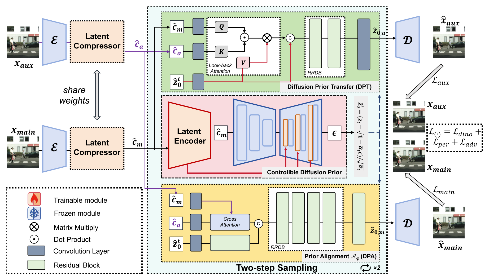
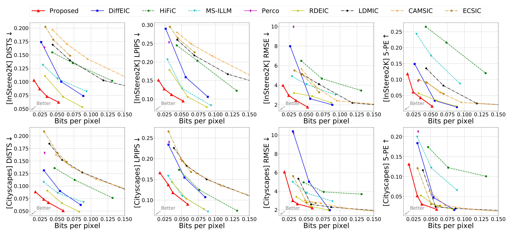
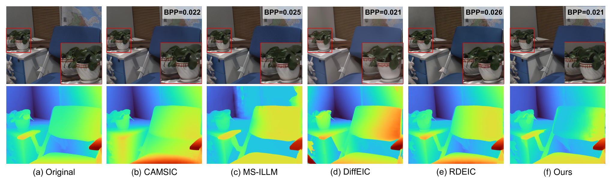

# SDiD: Shared Diffusion Prior for Efficient Distribute Stereo Image Compression

<sub><i>Official title reproduced verbatim from the camera-ready.</i></sub>

<p align="center">
  <a href="https://openreview.net/pdf?id=THGrvEnELu"></a>
  
  
  
  
</p>

**Reference inference code for SDiD** — distributed stereo image compression that reuses *one* frozen Stable Diffusion prior to decode **both views in two denoising steps** (NFE = 2), reconstructing consistent stereo pairs at roughly **0.02 bpp**.

<p align="center"><sub>
Yichong Xia · Yimin Zhou · Zongyu Li · Shiyu Qin · Mingyao Hong · Bin Chen · Haoqian Wang<br>
Tsinghua Shenzhen International Graduate School · Peng Cheng Laboratory · Harbin Institute of Technology (Shenzhen / Weihai)
</sub></p>
<p align="center"><sub>
<strong>Paper:</strong> ICML 2026, PMLR vol. 306 &nbsp;·&nbsp;
<strong>PDF:</strong> <a href="https://openreview.net/pdf?id=THGrvEnELu">OpenReview</a> &nbsp;·&nbsp;
<strong>Checkpoint:</strong> <i>coming soon</i>
</sub></p>


## Overview

Stereo image compression must deliver *two* views that are not only perceptually good but also **geometrically consistent**, because downstream depth estimation degrades on plausible-looking yet inconsistent pairs. VAE-based codecs optimise distortion and blur out at low bitrates; diffusion-based codecs restore texture but decode each view independently, which is slow and breaks consistency.

SDiD keeps **one** frozen Stable Diffusion prior shared by both views. The encoding end runs two *independent* latent compressors with **shared parameters** — a distributed architecture, so no inter-view information has to be exchanged before transmission. At the decoding end the prior is aligned to the compressed latent space (**DPA**), the actual noise level of the compressed representation is estimated with **ANE** to pick the starting time step, and the main-view prior is then transferred to the auxiliary view by **DPT**, whose **LBA** module looks back at both views. Both views come out of a single **two-step** denoising run, decoded in **1.41 s** per 1024 × 1024 image on one A6000.

- **DPA + ANE** — align a pretrained diffusion prior with the *compressed* latent space and estimate its noise level, so the main-view prior is obtained in a couple of steps rather than tens.
- **DPT + LBA** — transfer that prior to the auxiliary view while explicitly modelling inter-view correlation, keeping the decoded pair consistent.
- **Result** — best perceptual quality and downstream depth accuracy on InStereo2K and Cityscapes: **+255 %** over VAE-based distributed stereo codecs on perceptual metrics and **+48 %** on the downstream depth task. On InStereo2K, **one third of the bits** of the strongest baseline suffice for comparable depth accuracy.

## News & Roadmap

- **[2026-10]** Inference code, model configs and paper figures released.
- **[coming]** `sdid.ckpt` — pretrained SDiD weights. See [Checkpoints](#checkpoints) for the expected file layout.
- **[coming]** Entropy-coding module (`compress` / `decompress`) for real bitstreams. The current release estimates rate from the entropy model's likelihoods only.

## Method

<p align="center">
  
</p>
<p align="center"><sub>
<b>Figure 1.</b> Overview of SDiD in a distributed setting. Each view is encoded by an
independent latent compressor whose parameters are <i>shared</i> (RRDB: Residual in
Residual Dense Block), so nothing is exchanged between the two encoders. At the decoder,
both views are reconstructed from <i>one</i> denoising trajectory of a frozen foundation
diffusion model: DPA/ANE build the main-view prior, and DPT/LBA transfer it to the
auxiliary view.
</sub></p>

**Distributed encoding.** Both views go through `first_stage_model.encode` → `compress_model` with shared weights. The entropy model turns each feature into a quantised latent whose rate is estimated per slice; the two encoders never talk to each other.

**DPA + ANE.** `Get_index_fromSNR` compares the compressed latent with its lossless counterpart and buckets the resulting SNR into the DDPM forward SNR table, discretised into 50 steps (stride 20 over 1000). That gives the time step at which the compressed latent *already is*, instead of starting from pure Gaussian noise. Two DDIM updates then finish the main view.

**DPT + LBA.** In the same trajectory, `aux_view_trans` produces the auxiliary view from the main-view prior. Look-Back Attention takes queries from the auxiliary latent, keys from the compressed main latent and values from the main-view prior, so the transfer is conditioned on both views rather than on the main view alone.

## Results

<p align="center">
  
</p>
<p align="center"><sub>
<b>Figure 2.</b> Quantitative rate–distortion comparison on InStereo2K (top) and
Cityscapes (bottom) under four metrics: DISTS, LPIPS, RMSE and 5-pixel error. The first
two belong to perceptual quality, the last two to the downstream depth-estimation task.
SDiD stays on the favourable side of the baselines throughout, and the margin widens as
the bitrate drops, which is exactly the regime the paper targets.
</sub></p>

<p align="center">
  
</p>
<p align="center"><sub>
<b>Figure 3.</b> Qualitative comparison on InStereo2K at comparable bitrates — bpp is
printed in the top-right corner of each panel, and the depth map produced by
FoundationStereo is shown underneath every reconstruction. Of the six panels, SDiD is the
one that keeps both the texture of the plant and the depth structure of the chair and
table closest to the original.
</sub></p>

**Decoding cost.** Mean over 1024 × 1024 images on a single A6000. NFE is the number of diffusion-model function evaluations per decode.

| Method | Encode (s) | Decode (s) | Decode NFE |
|:--|--:|--:|--:|
| LDMIC | 5.36 | 15.70 | 1 |
| CAMSIC | 0.31 | 0.29 | 1 |
| HiFiC | 0.02 | 0.09 | 1 |
| MS-ILLM | 0.14 | 0.14 | 1 |
| PerCo | 0.78 | 14.89 | 30 |
| DiffEIC | 0.44 | 21.29 | 50 |
| RDEIC | 0.62 | 2.44 | 5 |
| **SDiD** | **0.50** | **1.41** | **2** |

## Installation

```bash
git clone <this-repo> SDiD && cd SDiD
conda create -n sdid python=3.10 -y && conda activate sdid
pip install torch torchvision --index-url https://download.pytorch.org/whl/cu121
pip install -r requirements.txt
```

## Checkpoints

**1. Bundled with this repository.** `ckpt/quant.pth` and `ckpt/post_quant.pth` (~1 KB each) are the two 1 × 1 projections of the VAE quantiser stage. `inference.py` points at them through `--quant_ckpt`, whose default is `./ckpt/`.

**2. Stable Diffusion 2.1 components.** Please download the VAE and UNet weights of Stable Diffusion 2.1 from Hugging Face and save them under `./ckpt/`. Ensure that the weights for both `first_stage_model.` and `model.diffusion_model` are present inside the `ckpt` directory.

**3. OpenCLIP ViT-H-14 text encoder.** The frozen text encoder is not stored in `sdid.ckpt`, so `--clip_pretrained` has to point at it. Pass the Hub tag `laion2b_s32b_b79k` and let OpenCLIP fetch the weights on first run, or download them once into the directory the default value expects:

```bash
huggingface-cli download laion/CLIP-ViT-H-14-laion2B-s32B-b79K \
    open_clip_pytorch_model.bin --local-dir ckpt/clip
```

`ckpt/clip/` is kept in the repository by a `.gitkeep` file only; the weights themselves are never committed.

**4. `sdid.ckpt` — not released yet.** The pretrained SDiD weights are **not available at the moment**. The layout below is what the released file will contain; `utils/checkpoint.py` already validates it and fails loudly, naming the missing tensor group, if you pass something else.

| Prefix in the checkpoint | Content |
|:--|:--|
| `control_model.*` | control encoder feeding the diffusion decoder |
| `tar.*` | `Time_aware_refinementS` (DPA) |
| `aux_view_trans.*` | `Timeaware_PriorTransfer` (DPT + LBA) |
| `compress_model.*` | shared latent compressor, including `quant.*` |

Release notes will be added to [News & Roadmap](#news--roadmap); watch this repository to be notified.

## Usage

Run **from the repository root** — `--quant_ckpt` defaults to `./ckpt/`, which is resolved against the current working directory.

```bash
python inference.py \
  --ckpt ./ckpt/sdid.ckpt \
  --sd_ckpt ./ckpt/sd_21.ckpt \
  --data_root ./data/InStereo2K \
  --split test \
  --save_dir results/instereo2k \
  --clip_pretrained ./ckpt/clip/open_clip_pytorch_model.bin \
  --device cuda:0
```

**Arguments**

| Flag | Description |
|:--|:--|
| `--ckpt` *(required)* | path to the SDiD checkpoint |
| `--sd_ckpt` *(required)* | path to the stable diffusion 2.1 checkpoint |
| `--data_root` *(required)* | dataset root containing `<split>/left` and `<split>/right` |
| `--split` *(`test`)* | dataset split name |
| `--save_dir` *(`results`)* | where reconstructions and `metrics.json` are written |
| `--clip_pretrained` | OpenCLIP ViT-H-14: a Hugging Face tag **or** a local `.bin`; defaults to `./ckpt/clip/open_clip_pytorch_model.bin`, which you have to populate yourself |
| `--quant_ckpt` *(`./ckpt/`)* | directory with `quant.pth` / `post_quant.pth`; only needed when the checkpoint does not carry `compress_model.quant.*` |
| `--steps` *(`2`)* | diffusion sampling steps; the default is `samplesteps` in `configs/sdid_inference.yaml` |
| `--header_bits` *(`4`)* | side-information cost of transmitting the ANE time step, in bits |
| `--prompt` | text conditioning, default `high-resolution, best quality, and extremely detail` |
| `--device` *(`cuda:0`)* | torch device, `cpu` is allowed but slow |
| `--max_images` *(all)* | evaluate only the first N pairs |
| `--no_save_images` | skip writing PNGs; `metrics.json` is always written |

Changing `--prompt` or `--header_bits` changes both the reconstruction and the reported bpp; leave them at their defaults to match the paper.


## Citation

```bibtex
@inproceedings{xia2026sdid,
  title={SDiD: Shared Diffusion Prior for Efficient Distribute Stereo Image Compression},
  author={Xia, Yichong and Zhou, Yimin and Li, Zongyu and Qin, Shiyu and Hong, Mingyao and Chen, Bin and Wang, Haoqian},
  booktitle={Forty-third International Conference on Machine Learning},
  year={2026}
}
```

If you build on the frozen diffusion prior, please also cite the original latent diffusion model (Rombach et al., CVPR 2022) and OpenCLIP.

## Acknowledgements

This work is supported in part by the National Natural Science Foundation of China under grant 624B2088, 62301189, 62571298, and Shenzhen Science and Technology Program under Grant KJZD20240903103702004, SYSPG20241211173609009.
